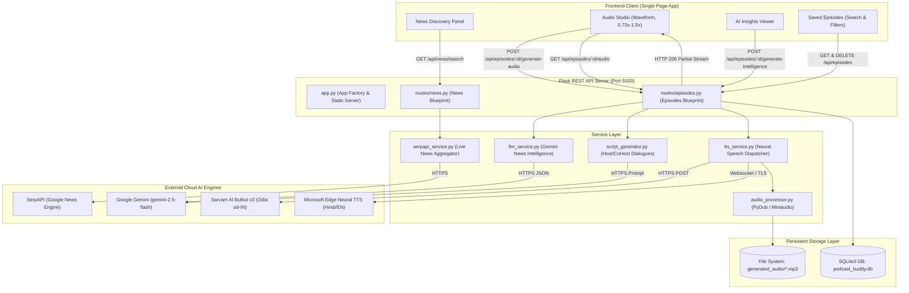

# Podcast Buddy — System Technical Architecture

## 1. High-Level Architectural Overview
Podcast Buddy follows a clean, decoupled **Layered Client-Server Architecture** designed for high modularity, predictable data flow, and minimal resource consumption:

```
┌─────────────────────────────────────────────────────────────────────────┐
│                       Client Layer (Web Browser)                        │
│   HTML5 • Vanilla ES6+ JavaScript • Modern Responsive CSS (Dark Theme)  │
│   News Curator • Audio Studio • Dynamic Waveform • Library & Filters    │
└────────────────────────────────────┬────────────────────────────────────┘
                                     │ REST JSON APIs / HTTP 206 Streaming
                                     ▼
┌─────────────────────────────────────────────────────────────────────────┐
│                 API & Routing Layer (Flask Blueprints)                  │
│       backend/app.py • backend/routes/news.py • backend/routes/episodes.py│
└───────┬────────────────────────────┬────────────────────────────┬───────┘
        │                            │                            │
        ▼                            ▼                            ▼
┌──────────────────┐       ┌──────────────────┐        ┌──────────────────┐
│   Data Access    │       │  AI & Synthesis  │        │ Audio Processing │
│  (SQLite3 / WAL) │       │ (External APIs)  │        │ (PyDub / C-Code) │
│  models/         │       │ services/        │        │ services/        │
│  database.py     │       │ serpapi, llm, tts│        │ audio_processor  │
└──────────────────┘       └──────────────────┘        └──────────────────┘
```

---

## 2. Mermaid Architecture Diagram



---

## 3. Detailed Component Architecture

### 3.1 Frontend Client Architecture
- **Architecture Style:** Lightweight Vanilla JavaScript SPA (Single Page Application).
- **Core Files:**
  - `frontend/index.html`: Semantic, accessible document structure structured into 5 logical workflow sections.
  - `static/css/style.css`: Modern dark theme using CSS custom properties (`--bg-main`, `--cyan`, `--primary`), flexbox/grid layouts, and media queries for responsive design down to 360px mobile viewports.
  - `static/js/app.js`: Clean client controller containing DOM manipulation, API interaction, local state, and keyboard event bindings.
- **Key Modules in `app.js`:**
  - **News Search & Selection Controller:** Tracks selected article IDs in a `Set()`, updates dynamic counters, and enforces the 1-to-5 selection rule.
  - **Audio Studio Controller:** Controls the HTML5 `<audio>` element, manages playback rate (`0.75x`, `1.0x`, `1.25x`, `1.5x`), seeks, adjusts volume, and activates the dynamic acoustic waveform bars via CSS keyframe animations.
  - **Speed Persistence Hook:** Listens to `loadedmetadata` and `play` events to re-apply the user's chosen playback speed whenever a new language track loads.
  - **Saved Episodes Search & Filter Engine:** Filters cached episode records in real time using title/description query matching and metadata dropdowns (language, readiness). Renders a friendly empty state when no episodes match.
  - **Keyboard Accessibility Controller:** Listens for global keydown events (`Space` for Play/Pause, `Left/Right` for ±15s seeking, `M` for mute) while safely ignoring events when the user is typing into input fields.

---

### 3.2 Flask Backend Architecture
- **Core File:** `backend/app.py`
- **Application Factory Pattern:** Flask app initialized with registered Blueprints:
  - `news_bp` mounted on `/api/news`
  - `episodes_bp` mounted on `/api/episodes`
- **CORS & Cache Control Middleware:**
  ```python
  @app.after_request
  def add_cors_headers(response):
      response.headers["Access-Control-Allow-Origin"] = "*"
      response.headers["Access-Control-Allow-Methods"] = "GET, POST, OPTIONS, DELETE"
      response.headers["Cache-Control"] = "no-cache, no-store, must-revalidate"
      return response
  ```
- **Error Handling Middleware:** All endpoints catch controlled custom exceptions and return uniform JSON error envelopes:
  ```json
  {
    "success": false,
    "error": "Human-readable error explanation",
    "code": "ERROR_CONSTANT_CODE"
  }
  ```

---

### 3.3 Relational Database Layer (SQLite 3)
- **Database File:** `podcast_buddy.db`
- **Configuration:** Initialized with Write-Ahead Logging (`PRAGMA journal_mode=WAL;`) for high concurrency and Foreign Keys enforced (`PRAGMA foreign_keys=ON;`).
- **Entity Relationship Schema:**

```sql
CREATE TABLE IF NOT EXISTS episodes (
    id INTEGER PRIMARY KEY AUTOINCREMENT,
    title TEXT NOT NULL,
    description TEXT,
    status TEXT DEFAULT 'draft',
    created_at TIMESTAMP DEFAULT CURRENT_TIMESTAMP,
    updated_at TIMESTAMP DEFAULT CURRENT_TIMESTAMP,
    ai_status TEXT DEFAULT 'not_started',
    ai_intelligence TEXT,          -- JSON string of Gemini analysis
    ai_generated_at TIMESTAMP,
    script_status TEXT DEFAULT 'not_started',
    podcast_script TEXT,           -- JSON string of Host/CoHost dialogue
    script_generated_at TIMESTAMP,
    audio_status TEXT DEFAULT 'not_started',
    audio_language TEXT,
    audio_path TEXT,               -- Primary audio file name on disk
    audio_generated_at TIMESTAMP,
    audio_error TEXT
);

CREATE TABLE IF NOT EXISTS episode_sources (
    id INTEGER PRIMARY KEY AUTOINCREMENT,
    episode_id INTEGER NOT NULL,
    article_id TEXT,
    title TEXT NOT NULL,
    publisher TEXT,
    snippet TEXT,
    date TEXT,
    url TEXT,
    created_at TIMESTAMP DEFAULT CURRENT_TIMESTAMP,
    FOREIGN KEY (episode_id) REFERENCES episodes(id) ON DELETE CASCADE
);
```

- **Computed Dynamic Enrichment:** The backend dynamically enriches episode records upon retrieval:
  - Scans `generated_audio/` for files matching `episode_{id}_{lang}_*.mp3`.
  - Populates `available_audio_languages: ["english", "hindi", "hinglish", "odia"]`.
  - Calculates sub-millisecond audio duration using `miniaudio.get_file_info()`.

---

### 3.4 Service Layer & External Integrations

#### 1. SerpAPI Integration (`backend/services/serpapi_service.py`)
- Communicates with `https://serpapi.com/search.json` using Google News engine (`tbm=nws`).
- Implements explicit finite timeouts: **5.0s connection timeout** and **10.0s read timeout**.
- Sanitizes and validates queries (1 to 200 characters).
- Filters raw news objects into clean dictionaries containing `article_id`, `title`, `publisher`, `snippet`, `date`, and `url`.
- Automatically redacts API keys from all error logs and exception messages.

#### 2. Google Gemini AI Integration (`backend/services/llm_service.py`)
- Uses model `gemini-2.5-flash` for high-speed, cost-effective inference.
- Implements strict **System Instructions** enforcing source-level factual grounding:
  - Rule 1: Never fabricate facts, dates, or statistics not present in the supplied source snippets.
  - Rule 2: Explicitly identify uncertainty and conflicts between publishers.
  - Rule 3: Output strictly valid JSON without conversational filler or Markdown fences.
- Parses output into structured keys: `overview`, `key_points`, `important_facts`, `entities`, `topics`, `corroborated_claims`, `unique_claims`, `conflicting_claims`, and `confidence_assessment`.

#### 3. Dual-Speaker Script Generator (`backend/services/script_generator.py`)
- Translates extracted intelligence into a multi-turn conversation between two hosts:
  - `"host"`: Dynamic lead presenter introducing topics and guiding transitions.
  - `"cohost"`: Analytical expert providing deep dives, counterpoints, and takeaways.
- Language-specific script enforcement:
  - **Hindi:** Requires genuine Devanagari script Unicode characters.
  - **Odia:** Requires genuine Odia script Unicode characters.
  - **Hinglish:** Natural conversational blend in Roman script.

#### 4. Multilingual TTS Service (`backend/services/tts_service.py`)
Dispatches dialogue lines to specialized neural engines based on language:

| Target Language | Provider Engine | Host Voice Persona | Co-Host Voice Persona | Delivery Mechanism |
|---|---|---|---|---|
| **English** | Microsoft Edge Neural | `en-GB-RyanNeural` (UK) | `en-IN-NeerjaNeural` (Indian) | Async WebSocket |
| **Hindi** | Microsoft Edge Neural | `hi-IN-MadhurNeural` (Male) | `hi-IN-SwaraNeural` (Female) | Async WebSocket |
| **Hinglish** | Microsoft Edge Neural | `hi-IN-MadhurNeural` | `en-IN-NeerjaNeural` | Async WebSocket |
| **Odia (ଓଡ଼ିଆ)** | Sarvam AI Bulbul v3 | `shubh` (Male, `od-IN`) | `kavya` (Female, `od-IN`) | REST HTTPS / Base64 |

#### 5. Audio Assembly & Post-Processing (`backend/services/audio_processor.py`)
- Uses **PyDub** with FFmpeg backend to assemble dialogue clips.
- Inserts a **250ms silence buffer** between alternating speaker turns to simulate realistic human conversational cadence.
- Applies loudness normalization to standard podcast broadcast target of **-16 dBFS**.
- Employs **Miniaudio** for ultra-fast duration calculation during episode listing.

---

### 3.5 Audio Streaming Flow (HTTP 206 Partial Content)
To enable instantaneous seeking and audio scrubbing without waiting for the full MP3 to download:
1. Browser sends `GET /api/episodes/<id>/audio?lang=<language>` with header `Range: bytes=0-`.
2. Flask inspects the requested byte range and file size on disk.
3. Flask responds with `HTTP 206 Partial Content`, headers `Content-Range: bytes <start>-<end>/<total>`, `Content-Type: audio/mpeg`, and writes the requested byte chunk.
4. If `?download=1` is passed, Flask attaches `Content-Disposition: attachment; filename=podcast_buddy_ep<id>_<lang>_<title>.mp3`.

---

### 3.6 Communication Protocol & REST API Endpoints

| Method | Endpoint | Description | Key Request / Query Parameters | Response Status |
|---|---|---|---|---|
| `GET` | `/health` | Server Health Status | None | `200 OK` |
| `GET` | `/app` | Serve Web Application UI | None | `200 OK` (HTML) |
| `GET` | `/api/news/search` | Query Live News via SerpAPI | `?q=<search_query>` | `200 OK` / `400` / `502` |
| `GET` | `/api/episodes` | List Stored Episodes | None | `200 OK` |
| `POST` | `/api/episodes` | Create Episode with Sources | JSON: `{title, description, articles}` | `201 Created` |
| `GET` | `/api/episodes/<id>` | Get Episode Details & Sources | Path: `id` | `200 OK` / `404` |
| `DELETE`| `/api/episodes/<id>` | Delete Episode & Audio Files | Path: `id` | `200 OK` / `404` |
| `POST` | `/api/episodes/<id>/generate-intelligence` | Synthesize Gemini AI Insights | Path: `id` | `200 OK` / `500` |
| `POST` | `/api/episodes/<id>/generate-script` | Draft Host/CoHost Script | JSON: `{language: "hindi"|"odia"|"english"}` | `200 OK` / `500` |
| `POST` | `/api/episodes/<id>/generate-audio` | Synthesize Neural Podcast Audio | JSON: `{language: "hindi"|"odia"|"english"}` | `200 OK` / `500` |
| `GET` | `/api/episodes/<id>/audio` | Stream or Download MP3 Track | `?lang=<lang>&download=1` | `206 Partial` / `200` |

